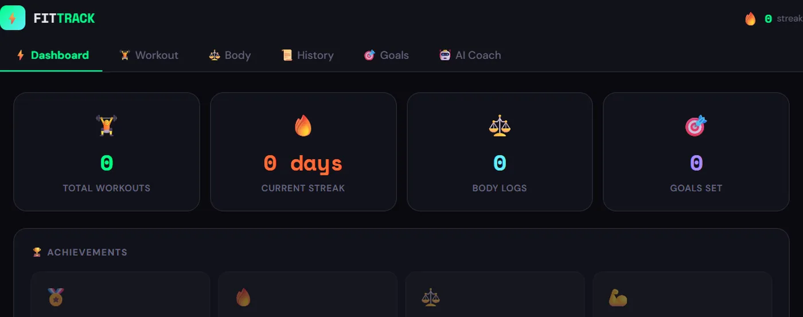
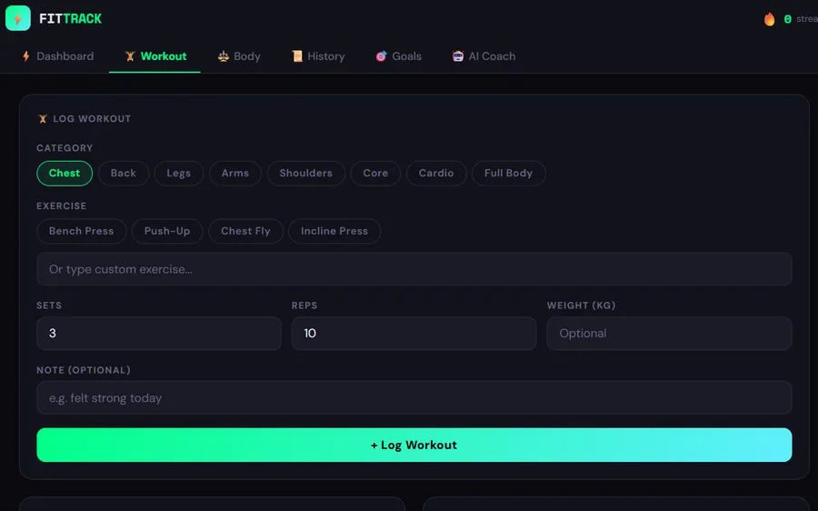
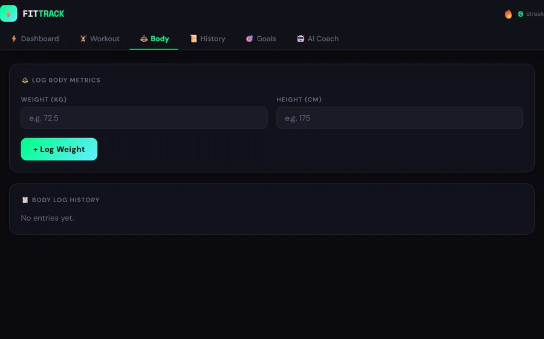

# FitTrack


A desktop fitness tracker for **managing regular workouts and progressive overload**. Log sets, reps and weight by muscle group, review past sessions to beat your last numbers, track body weight over time, set goals and keep your streak alive.

<p align="center">
  
</p>
<p align="center">
  
  
</p>

## Features

- **Dashboard:** total workouts, current streak, body-log entries and goals at a glance.
- **Workout logger:** pick a category (chest, back, legs, arms, shoulders, core, cardio, full body), choose or type an exercise, then record sets, reps, weight and a note.
- **Rest timer** between sets.
- **Body tracking:** log body weight and height and see the history as a chart.
- **History:** browse every past workout so you can beat last session's numbers.
- **Goals:** create goals such as "Bench 100 kg" or "Workout 5x/week" and tick them off.
- **Achievements and streaks** to keep you consistent.
- **AI Coach (optional):** ask for a workout suggestion or a progress review using a **local** [Ollama](https://ollama.com) model, so your data never leaves your computer.
- **Offline first:** everything is saved on your device.

## Tech stack

| Layer | Technology |
| --- | --- |
| Shell | Electron 28 (secure preload bridge, context isolation) |
| UI | React 18 (Create React App) |
| Charts | Recharts |
| Storage | Browser `localStorage` inside Electron |
| Packaging | electron-builder (NSIS Windows installer) |

## Project structure

```
Fitness-Tracker/
├── main.js          # Electron main process (window, menu)
├── preload.js       # Secure bridge between Electron and React
├── package.json     # Dependencies and build config
├── public/
│   └── index.html   # HTML shell
└── src/
    ├── index.js     # React entry point
    └── App.jsx      # The whole FitTrack app
```

## Getting started

### Prerequisites

- [Node.js](https://nodejs.org/) 18 or newer
- npm (comes with Node)
- Optional, for the AI Coach: [Ollama](https://ollama.com) with a model pulled, for example `ollama pull llama3`

### Install and run

```bash
git clone https://github.com/Shahith645/Fitness-Tracker.git
cd Fitness-Tracker
npm install
npm run dev
```

`npm run dev` starts the React dev server on port 3000 and opens the Electron window once it is ready.

### Build a Windows installer

```bash
npm run dist
```

The `.exe` installer is created in the `dist/` folder.

> The build config points to `public/icon.ico`. Add your own icon file there, or remove the `icon` lines from `package.json`, before running `npm run dist`.

### Using the AI Coach

1. Start Ollama: `ollama serve`
2. Pull a model: `ollama pull llama3`
3. Open the **AI Coach** tab and pick the model (or type your own).

## Author

**Shahith S**, final-year CSE student at University College of Engineering, Nagercoil
[GitHub](https://github.com/Shahith645) · [LinkedIn](https://www.linkedin.com/in/shahith-s/)
